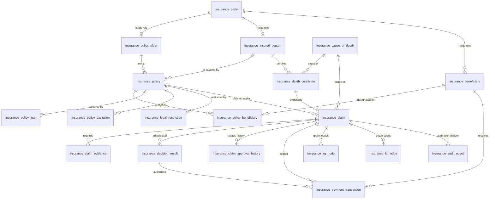

# Claims domain data model

23 tables in `auto_ontology/insurance/schema.py`, created by migration
`c4a7f1b9d2e6` (which revises `caee572fa81c`). They live in the platform's
default Postgres schema alongside the Auto-Ontology catalog, or in SQLite for the
standalone demo.

## Modelling principles

**Roles, not copies.** `insurance_party` holds a person once. Policyholder,
insured and beneficiary are role rows pointing at it. A spouse who is the
insured's beneficiary and the claimant is one party with three roles, linked in
the graph by `sameAs`.

**Designation properties stay on the designation.** `allocation_percent` is on
`insurance_policy_beneficiary`, because the same person can be 100% primary on
one policy and contingent on another.

**Money is integer cents; percentages are basis points.** `types.py` converts at
the boundary. "Exactly 100%" and "exactly $250,000.00" are only provable with
integers; a float column makes both approximately true.

**Derived layers are rewritten, never appended.** A claim's graph, its current
decision and its catalog projections are replaced in place (or superseded by
`is_current`), so a re-run cannot leave two truths.

## The tables

### Parties and roles

| Table | Purpose | Key points |
| --- | --- | --- |
| `insurance_party` | One row per person/organisation | Names, DOB, contact, `tax_id_last4` only |
| `insurance_policyholder` | Ownership role | Unique party, customer number |
| `insurance_insured_person` | Covered-life role | Risk attributes (occupation, smoker) |
| `insurance_beneficiary` | Beneficiary role | Relationship to insured, `beneficiary_class` PRIMARY/CONTINGENT, verification status and verifier |
| `insurance_policy_beneficiary` | Designation | Allocation %, order, designation type, active flag, effective date |

*Requested concept mapping:* **Beneficiary / Primary / Secondary** are the
`beneficiary_class` and `designation_type` values (`PRIMARY` / `CONTINGENT`);
**Spouse** is the `relationship_to_insured` value plus the ontology class
`lio:Spouse` and a `spouseOf` graph edge. Neither needs its own table: a
"spouse" is a relationship asserted at a point in time, not an entity with
independent attributes.

### Contract

| Table | Purpose | Key points |
| --- | --- | --- |
| `insurance_policy` | The contract | Product, effective/expiry, face amount, premium, status, `contestability_days` |
| `insurance_policy_loan` | Loans against cash value | Principal and **outstanding_balance**; repaid loans stay for history |
| `insurance_policy_exclusion` | Contractual carve-outs | `excludes_cause_class` (ontology IRI), `contestability_only` |
| `insurance_legal_restriction` | Liens, trusts, court orders, fraud holds | Optional `claim_id`; `status` ACTIVE/RELEASED |

*Requested concept mapping:* **Contestability Period** is not a table. It is a
per-policy duration (`contestability_days`) whose dates are derived, plus the
semantic definition `past_contestability`. A separate table would duplicate the
effective date and permit the two to disagree.

### Claims and evidence

| Table | Purpose | Key points |
| --- | --- | --- |
| `insurance_cause_of_death` | ICD-10 reference | Code, category, `ontology_class_iri`, self-inflicted flag |
| `insurance_death_certificate` | Official death record | Certifies an insured person, cause, physician, document hash, verification |
| `insurance_claim` | The assertion | Policy, insured, claimant, certificate, date of death, stated cause, status |
| `insurance_claim_evidence` | Supporting documents | One row per type per claim, status, verifier, document hash |

The claim restates the insured and cause rather than deriving them from the
policy: the ontology checks compare the *claimant's assertion* with the policy
and certificate. Deriving it would make C1/C3 vacuous.

### Semantic layer

| Table | Purpose | Key points |
| --- | --- | --- |
| `insurance_semantic_definition` | Certified metric catalog | Name, kind, formula, unit, dependencies, version, owner, certification |

Definitions are metadata; **values are never stored here**. A decision stores
the values it used (`insurance_decision_result.semantic_calculations`), which is
what makes the decision reproducible after a definition changes.

### Ontology (T-Box)

| Table | Purpose |
| --- | --- |
| `insurance_ontology_entity` | Classes and (future) individuals; one row per parent for multiple inheritance |
| `insurance_ontology_relationship` | Properties with domain, range, cardinality, transitive/symmetric flags |

These are a queryable projection of `ontology/vocabulary.py`, rebuilt by
`materialize_ontology`. Python stays authoritative.

### Knowledge graph (A-Box)

| Table | Purpose |
| --- | --- |
| `insurance_kg_node` | Claim-scoped node: id (`PrimaryBeneficiary:BEN-3001`), ontology class, label, source table/id, properties (including `ontology_types`) |
| `insurance_kg_edge` | Claim-scoped edge: from, to, relation IRI, properties |

Nodes reference their source row but **store no new facts**; the graph is a
typed projection. Edges cascade with the claim, and a rebuild deletes before
inserting.

### Decision and payment

| Table | Purpose | Key points |
| --- | --- | --- |
| `insurance_decision_rule` | Rule catalog | Severity, `on_fail_action` (DENY/REFER/INFORM), expression, version, priority |
| `insurance_decision_result` | Decision | Status, payout, `is_current`, rule outcomes, three evidence payloads, explanation, audit ref, engine version |
| `insurance_claim_approval_history` | Status transitions | From/to status, action, actor, approval level (AUTOMATED / PENDING_HUMAN / HUMAN_APPROVED) |
| `insurance_payment_transaction` | Simulated disbursement | Amount, status, unique idempotency key, authorisation and provider refs, approver, verification status |
| `insurance_audit_event` | Hash-chained trail | Actor, action, entity, correlation id, `previous_hash`, `event_hash` |

## Sample data

| Scenario | Claim | Policy | Death | Expected outcome |
| --- | --- | --- | --- | --- |
| A - standard | `CLM-2001` | `POL-1001`, $250,000 20-year term, effective 2021-06-15 | 2026-06-14, `I21.9` heart attack, 1,825 days in force | `AUTO_APPROVED`, $250,000, paid to spouse |
| B - exception | `CLM-2002` | `POL-1002`, $400,000, effective 2020-01-10 | 2026-05-30, `V89.2` motor-vehicle accident | `MANUAL_REVIEW` (court order, outstanding $25,000 loan) |

Scenario A deliberately includes a **repaid** loan ($0 balance) to prove the
semantic layer nets balances, not principal. Scenario B proves that passing
coverage rules is not enough when a legal restriction exists.

## Postgres notes

Verified end to end on PostgreSQL 17.11 (`pgvector/pgvector:pg17`):
`alembic upgrade head` creates 23 tables and 292 constraints, `alembic check`
reports no drift across both metadata objects, `downgrade -1` leaves 0
`insurance_%` tables, and `upgrade head` recreates them. The full test suite and
the claim scenario produce the same amounts, graph and audit reference as SQLite.

* All 23 tables are unqualified, so they land in the connection's default
  schema (`public`), the same place the platform's catalog lives.
* `alembic/env.py` registers both `METADATA` and `INSURANCE_METADATA` as
  targets; otherwise the claims tables would appear as drift and autogenerate
  would propose dropping them.
* `Money`/`Percent` are `BigInteger` in every dialect - no `NUMERIC` round-trip.
* JSON columns use SQLAlchemy's portable `JSON` (Postgres `json`), not `JSONB`:
  the payloads are audit records read whole, not queried by key.
* The migration creates tables with `INSURANCE_METADATA.create_all`, so the
  model and the DDL cannot diverge. `alembic check` compares against the same
  metadata.
* `DateTime` columns become `timestamp without time zone`. The audit chain
  canonicalises timestamps to naive UTC before hashing, so verification is
  intact on both dialects - the SQLite round-trip drops the offset for the same
  reason and is handled by the same function.
* `Boolean` comes back as a real boolean on Postgres; the domain only reads
  booleans through SQLAlchemy, never as string/int literals, so the two dialects
  agree.
* Constraints are enforced, not decorative: Postgres rejects an invalid
  `category` with `ck_insurance_cause_of_death_category` and a dangling
  policyholder with `fk_insurance_policy_policyholder_id_insurance_policyholder`.
  SQLite enforces both too (CHECK natively, foreign keys via the `PRAGMA` the
  engine sets on connect).
